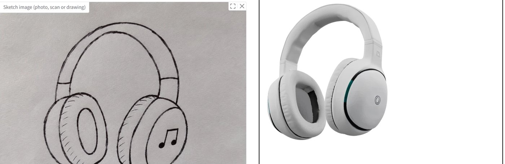
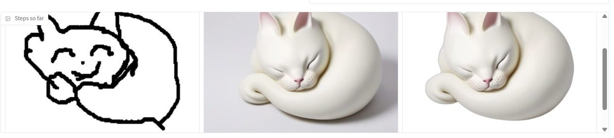
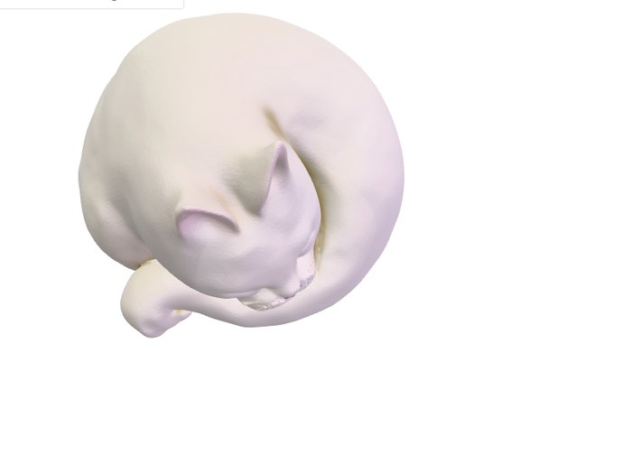
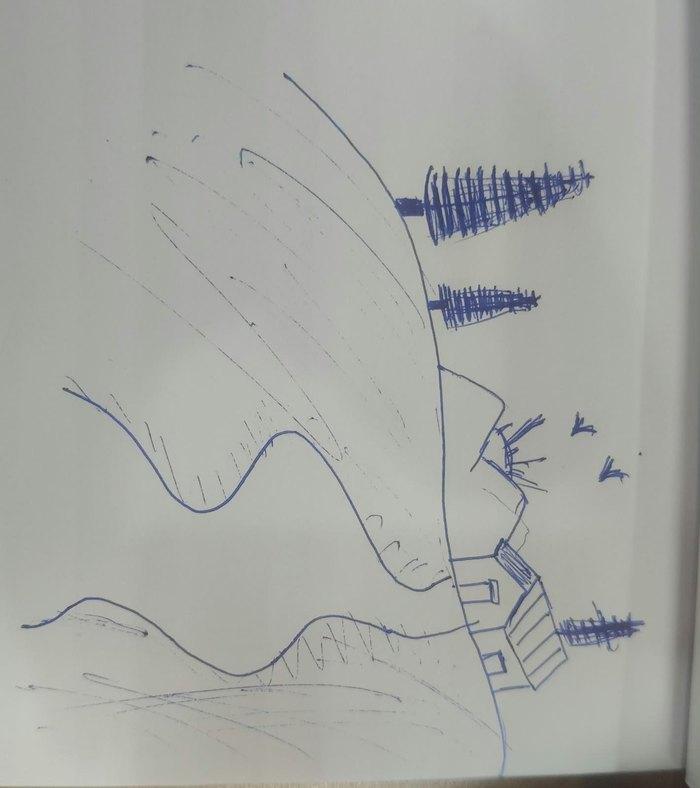
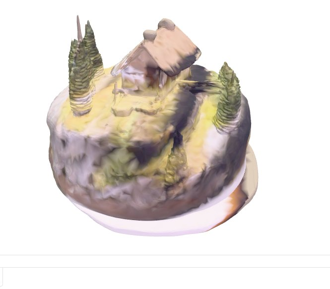
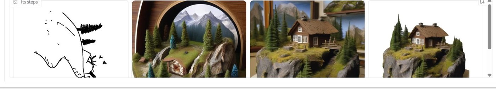
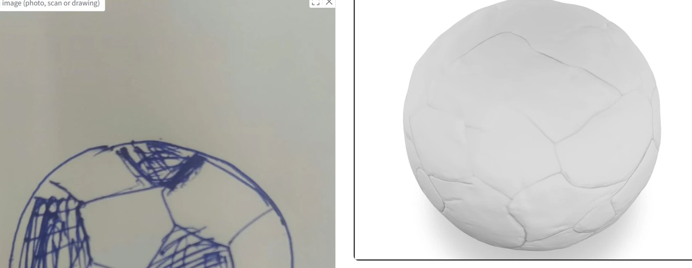

# Sketch2Shape

**From a 2D sketch to a textured, exportable 3D model.** Draw on a canvas or upload a photo of a
sketch, optionally describe the object, and get a textured `.glb` and a zipped `.obj` that open in
Blender, Windows 3D Viewer or any glTF viewer. Runs on free hardware (Kaggle, 2x NVIDIA T4).

Built in 24 hours for TechZephyr 4.0 (IIT Bhubaneswar), problem statement *Sketch2Shape AI*.

| | |
|---|---|
| Full technical documentation | [docs/DOCUMENTATION.md](docs/DOCUMENTATION.md) |
| Architecture decision (PDF) | [docs/Sketch2Shape Architecture Decision.pdf](docs/Sketch2Shape%20Architecture%20Decision.pdf) |
| Kaggle notebook (setup + app) | [notebooks/kaggle_run.ipynb](notebooks/kaggle_run.ipynb) |



## What it does

- **Two ways in:** draw on a canvas (brush, eraser, undo, clear) or upload a PNG/JPG/WebP (canvas export, scan or phone photo). Example sketches are one click away.
- **Optional description:** type the object, colour, material or style ("a red ceramic mug"). It is never required.
- **Cleans the input:** flattens transparency, evens out paper lighting, removes specks, crops and centres, closes gaps, turns dense hatching into outlines, and turns sideways photos upright.
- **Understands the sketch:** names the object, judges whether the drawing is clean or a rough doodle, and whether it is one object or a whole scene (a vision LLM if a key is set, CLIP otherwise).
- **Generates a realistic image that follows the lines:** Stable Diffusion XL with a scribble ControlNet, with settings chosen per kind of sketch by side-by-side tests.
- **Checks the image before building 3D:** a vision LLM rejects frames, rings, background scenery, extra objects, cut-off parts and flat plaques; line-match scores confirm the pick follows the sketch. Bad images are regenerated.
- **Builds a real 3D model:** background removal, then Hunyuan3D-2 for the shape and the texture, then mesh checks (enough faces, not flat, no loose fragments, texture present) with automatic retries and fallbacks.
- **Previews and exports:** a rotatable 3D viewer, step-by-step images while it works, `model.glb` (texture embedded) and `model_obj.zip` (OBJ + MTL + texture), plus a list of earlier models kept while the app runs.
- **Robust app:** live progress panel, Cancel button, one run at a time, every run logged in a `manifest.json` (inputs, settings, seeds, scores, timings, warnings).

## Results

All examples below are real outputs of the app on Kaggle's free 2x T4, made live from the input shown.

| Input | What the app made |
|---|---|
| **Phone photo of a pen sketch** (headphones, no description). Clean drawing: one product-style image, full sketch control. | Textured headphones with the arched band, both ear cups and padding (top of this page). |
| **Rough mouse doodle** of a sleeping cat on the canvas. Judged a rough doodle: lighter sketch control, realistic prompt, two images, GPT picks one. |   |
| **Sideways phone photo of a landscape** (hills, pine trees, a cabin, birds). Turned upright and recognised as a scene, so it is built as a miniature diorama. The first round was rejected by the image check (a round frame, scenery behind); the second passed. |   |
| |  |

**A limitation, shown honestly:** a football with hatched black panels became a white ball. The
hatching is turned into panel outlines (so it is not copied as scribbles), but the colour it stood
for is lost for clean drawings.



Example output files: [`examples/outputs/`](examples/outputs/) holds GLB and OBJ files made by the
app, with their input sketches.

## Time and hardware

| | |
|---|---|
| Hardware used | Kaggle notebook: 2x NVIDIA T4 (15 GB usable each), 4 vCPU, 30 GB RAM, ~57 GB disk |
| Software | Python 3.13, PyTorch 2.11 + CUDA 12.8, diffusers, transformers, Gradio 6 |
| One-time setup | about 15-25 min on a fresh session: Hunyuan3D-2 install, two CUDA extensions (~25 s), ~20 GB of model weights |
| Time per 3D model | **measured 357-389 s** (1 Nov, when every step loaded its model). With the models now kept loaded between runs, a run after the first is expected to take **about 3-4 min**; the first run after the app starts takes ~5 min while models load |
| GPU memory (peak) | SDXL 13.4 GB (GPU 0), shape 6.2 GB (GPU 1), texture 12.7 GB (GPU 0) |
| CPU RAM (peak per process) | SDXL worker 6 GB, shape worker 14.6 GB, texture worker 15.5 GB, app ~4-6 GB |

Per-step measurements, the GPU and RAM plan and how loading time was removed are in
[the documentation](docs/DOCUMENTATION.md#7-performance-and-resources). Every run's own timings are in
its `manifest.json` and under **Run details** in the app.

## Quick start (Kaggle, free, recommended)

1. Open [kaggle.com](https://www.kaggle.com), **Create → New Notebook → File → Import Notebook**, and import `notebooks/kaggle_run.ipynb` from this repository (it clones https://github.com/RohanSaikumar/sketch2shape itself).
2. **Session options:** Accelerator **GPU T4 x2**, Internet **On** (phone verification is needed once for GPUs).
3. **Optional secrets** (Add-ons → Secrets, then switch them on for the notebook): `OPENAI_API_KEY` for the vision-LLM steps (naming and the image check), or `ANTHROPIC_API_KEY`; `HF_TOKEN` only to raise Hugging Face download limits. Without a key the app still works (CLIP names the object, line scores alone pick the image).
4. **Run cells 1 → 4 in order** (or Run All):
   1. checks the GPUs and clones the code;
   2. loads the optional keys;
   3. one-time setup, 15-25 min on a fresh session; it prints its progress and stops with the log if anything fails;
   4. starts the app and prints its public link, `Open the app: https://….gradio.live`.
5. Open the link, draw or upload a sketch, optionally describe it, click **Make 3D model**, then download the result from **Downloads** (GLB and OBJ zip). Every run is also saved in `runs/<run id>/`.

Cells 5-9 are optional: the app's log, stopping the app, offline tests, a batch run on the example
sketches, and a results table. Cells 6-8 only act when their switch is set to `True`, so Run All ends
with the app running. Rerunning cell 4 restarts the app with a new link. The first model after the app
starts is slower while models load; the status line under the progress bar says when SDXL and the 3D
shape model are ready.

## Other ways to run

**Linux with an NVIDIA GPU (16 GB or more).** PyTorch with CUDA must already be installed.

```bash
git clone https://github.com/RohanSaikumar/sketch2shape.git && cd sketch2shape
bash scripts/setup.sh                 # Hunyuan3D-2 (pinned), its CUDA extensions, our requirements, weights
python app.py                         # web app on http://localhost:7860  (add --share for a public link)
```

**Command line, batch and tests**

```bash
python -m sketch2shape.cli sketch.png --prompt "a red ceramic mug"   # one model, prints the output paths
python scripts/eval_batch.py examples/sketches --prompts examples/prompts.json --out results
python scripts/collect_results.py --last 8      # results table and picture strips from app runs
python -m pytest -q tests                       # 50 offline tests, no GPU needed
```

## Inputs and outputs

- **Input:** a canvas drawing or an image of a sketch (PNG, JPG, WebP), any size, any background; optional text description.
- **Output** in `runs/<run id>/`:
  - `model.glb`: textured mesh, normalised (centred, 1 unit tall/wide, Y-up, resting on y = 0), ~40k faces;
  - `model_obj.zip`: the same as OBJ + MTL + texture PNG;
  - every intermediate: `01_input.png`, `02_lineart.png`, `03_control.png`, `04_sketch_mask.png`, `05_candidate_*.png`, `06_prepared.png` (input to 3D), `07_shape_seed*.glb`, `09_textured.glb`;
  - `manifest.json`: inputs, settings, seeds, prompts, scores, image-check verdicts, worker timings and RAM, warnings and library versions.

## Architecture in one picture

```
sketch (+ optional text)
  1 preprocess   clean line art, sideways photos turned upright, hatching -> outlines
  2 understand   name, clean/rough, object/scene (vision LLM, or CLIP)  -> prompt per kind of sketch
  3 generate     SDXL + scribble ControlNet (1 image for clean drawings, 2 for rough ones and scenes)
  4 gate 1       vision LLM picks a usable image; line match + silhouette + CLIP confirm it
                 -> rejected: new seeds and "avoid" words; drifted: follow the lines harder
  5 prepare      background removal, crop, centre
  6 reconstruct  Hunyuan3D-2 shape (turbo, FlashVDM), clean-up, then Hunyuan3D-2 texture
  7 gate 2       faces, flatness, fragments, texture -> new seed, or colours projected from the image
  8 export       normalise, GLB + OBJ, reload test
```

A small explicit state machine (`sketch2shape/pipeline.py`) runs the stages and owns every retry, with
attempt limits and a time budget; once any mesh exists, an unexpected error still exports the best
result. Each heavy model runs in its own GPU worker process, so the big models never share CPU RAM and a
crash in one cannot take down the app. With two GPUs, SDXL and the shape model stay loaded between runs
and the texture model loads while earlier steps run, all guarded by free-RAM checks. Details and the
reasons behind each choice: [docs/DOCUMENTATION.md](docs/DOCUMENTATION.md).

## Models, external services and third-party components

| Component | Used for | Licence / terms |
|---|---|---|
| [Stable Diffusion XL base 1.0](https://huggingface.co/stabilityai/stable-diffusion-xl-base-1.0) | sketch-guided image generation | CreativeML Open RAIL++-M |
| [xinsir/controlnet-scribble-sdxl-1.0](https://huggingface.co/xinsir/controlnet-scribble-sdxl-1.0) | keeps the sketch's lines | Apache-2.0 |
| [madebyollin/sdxl-vae-fp16-fix](https://huggingface.co/madebyollin/sdxl-vae-fp16-fix) | fp16-safe SDXL VAE | MIT |
| [Hunyuan3D-2](https://github.com/Tencent-Hunyuan/Hunyuan3D-2) shape (`hunyuan3d-dit-v2-0-turbo`) and paint models, code pinned at `f8db630` | image to 3D shape and texture | Tencent Hunyuan 3D 2.0 Community License (non-commercial; not licensed in the EU, UK and South Korea) |
| Background removal: [rembg](https://github.com/danielgatis/rembg) through Hunyuan3D-2's `BackgroundRemover` | cut-out before 3D | rembg MIT; its default model in current versions is [BRIA RMBG-2.0](https://huggingface.co/briaai/RMBG-2.0) (CC BY-NC 4.0, non-commercial), in older versions u2net (Apache-2.0) |
| [CLIP ViT-B/32](https://huggingface.co/openai/clip-vit-base-patch32) | naming without a key, image-text agreement score | MIT |
| OpenAI API, optional (`gpt-4.1-mini`, then `gpt-5-mini`, `gpt-4o-mini`) | naming the sketch and the image check: about 2 calls per run, images at low detail, well under one cent | external service, `OPENAI_API_KEY` |
| Anthropic API, optional alternative (`claude-opus-5-5`) | same, used when only `ANTHROPIC_API_KEY` is set | external service |
| [Google model-viewer](https://modelviewer.dev) 3.5.0, loaded from cdn.jsdelivr.net | 3D preview in the browser | Apache-2.0 |
| PyTorch, diffusers, transformers, accelerate, OpenCV, trimesh, Gradio, onnxruntime | libraries | BSD / Apache-2.0 / MIT |

No dataset was used and no model was trained or fine-tuned. Model weights download from Hugging Face
(rembg's from its GitHub releases) on first use; `scripts/prefetch_weights.py` (run by setup) fetches
them ahead of time. API keys are read from environment variables or Kaggle Secrets, never stored in the
code.

## Reproducibility

| | |
|---|---|
| Environment | Linux, NVIDIA GPU with CUDA (2x T4 tested; one 16 GB+ GPU also works), Python 3.10+ (3.13 tested), internet for the first download |
| Install | `scripts/setup.sh`: clones Hunyuan3D-2 at the pinned commit `f8db630`, compiles its two CUDA extensions for the GPU found, applies one compatibility patch (`trust_remote_code` for newer diffusers), installs `requirements.txt`, prefetches weights |
| Model weights | public Hugging Face repositories listed above; no gated model is needed. `HF_TOKEN` is optional |
| External services | optional OpenAI or Anthropic API key; without one every step still runs (CLIP fallback) |
| Configuration | `config.yaml` (every setting, with comments); a run records the full configuration, seeds and library versions in its `manifest.json` |
| Determinism | fixed seeds for image generation (42 + 1000 per round) and shape (1234 + 7919 per attempt); the vision LLM's answers can vary between runs |
| Checks | `python -m pytest -q tests` (50 offline tests); the app's Run details show every step's outcome |

## Limitations

- **One view only.** A single sketch does not show the back or the inside, so hidden surfaces are plausible guesses, not recovered geometry.
- **Colour from shading is lost on clean drawings.** Hatching becomes an outline so it is not copied as scribbles; a hatched football came out white. A typed description ("black and white football") restores the colour.
- **Scenes become dioramas.** A landscape with several things is built as one miniature diorama on a round base, so it follows the sketch's content more than its exact layout.
- **Thin parts** (chair legs, handles, spouts) can thicken, merge or break; the mesh checks catch empty or flat results, not every thin part.
- **Generated textures** do not reproduce fine sketch details (text, small patterns) exactly, and hidden sides are painted by the model.
- **Time:** about 3-6 minutes per model on free T4s, mostly the texture step; one model is made at a time.
- **Hardware:** needs an NVIDIA GPU with 16 GB or more (two T4s, or one larger GPU) and about 30 GB of RAM; no CPU-only mode.
- **Licences:** Hunyuan3D-2 and the default background-removal model are for non-commercial use only.
- **Not production geometry:** meshes are for viewing and further editing, not print-ready or animation-ready topology (outside the problem's scope).
- **Vision-LLM steps are optional but help.** Without a key, naming uses a fixed list of 181 objects and the image check is skipped, so odd objects may be misnamed and bad images are caught only by line scores.

## Troubleshooting

| Problem | Fix |
|---|---|
| No GPU / `No CUDA GPU found` | Kaggle: Session options → Accelerator **GPU T4 x2**, then rerun from cell 1. |
| `... contains custom code in pipeline.py ... Pass trust_remote_code=True` | Run `scripts/setup.sh`; it patches Hunyuan's multiview loader for newer diffusers. |
| CUDA extension build fails with pip | `setup.sh` falls back to `python setup.py install`; the log is in `/tmp/s2s_build_<name>.log`. |
| Setup (cell 3) stopped with an error | The end of the log is printed under the cell; the full log is `/kaggle/working/setup.log`. Rerun cell 3: finished steps are skipped. |
| Cell 4 printed the log instead of a link | Rerun cell 4. Check that Internet is On; the log under the cell (or cell 5) shows the error. |
| "Your notebook tried to allocate more memory than is available" | Do not run the example batch (cell 8) while the app is running; stop it first (cell 6). Every step logs `free_ram_gb` in `manifest.json` → `transitions`. |
| Run details: `"texture_mode": "projected colours"` | The texture step failed (the warning says why) and colours were projected from the image instead. RAM-short cases now stop kept models before the texture loads. |
| A step fails with "... worker failed" | Open the log named in the message (`runs/<id>/worker_*.log`, or `runs/_workers/serve_*.log` for a kept model). |
| The 3D preview stays empty | The viewer script comes from cdn.jsdelivr.net; check the network allows it. The files under **Downloads** are complete either way. |
| "The sketch looks empty" | Draw darker or thicker lines, or upload a higher-contrast photo. |
| The first model is slow | Models are still loading; wait for "SDXL ready · 3D shape model ready" under the progress bar. |
| The gradio.live link stopped working | Rerun the app cell (it stops the old app and prints a new link); links expire after 72 hours or when the session ends. |
| GPU 0 out of memory in `eval_batch.py` | The app keeps SDXL loaded on GPU 0; stop the app first. |

## Repository layout

```
app.py                      Gradio app (canvas, upload, progress, viewer, downloads, earlier models, cancel)
config.yaml                 every setting, commented
sketch2shape/pipeline.py    state machine: stages, transitions, retries, time budget, cancel
sketch2shape/models.py      GPU worker processes (kept / early / fresh), RAM guard, CPU models
sketch2shape/worker.py      worker process: load a model once, run jobs (SDXL, shape, texture)
sketch2shape/llm.py         optional vision-LLM calls (OpenAI or Anthropic)
sketch2shape/stages/        preprocess, understand, generate, image_check, score, prepare, reconstruct,
                            validate, export
scripts/                    setup, weight prefetch, batch evaluation, results collection, comparisons
notebooks/kaggle_run.ipynb  the Kaggle notebook
tests/                      offline tests
docs/                       documentation, architecture decision PDF, images
examples/                   example sketches, prompts and outputs
```
