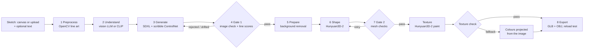
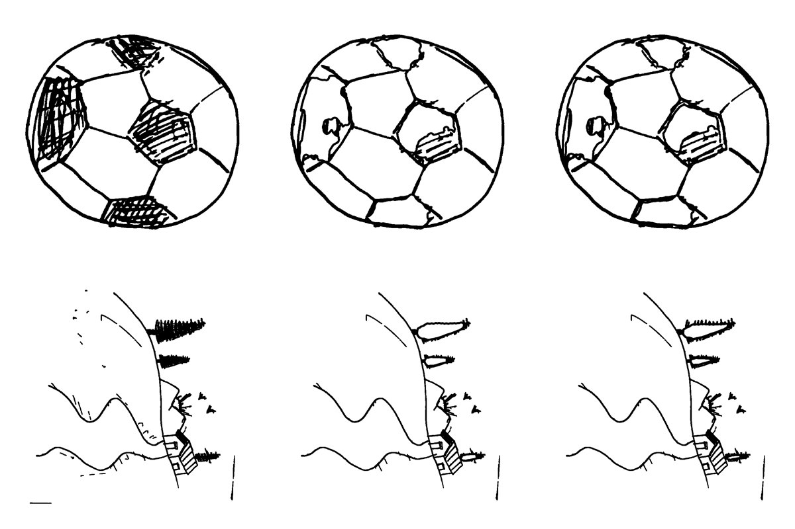
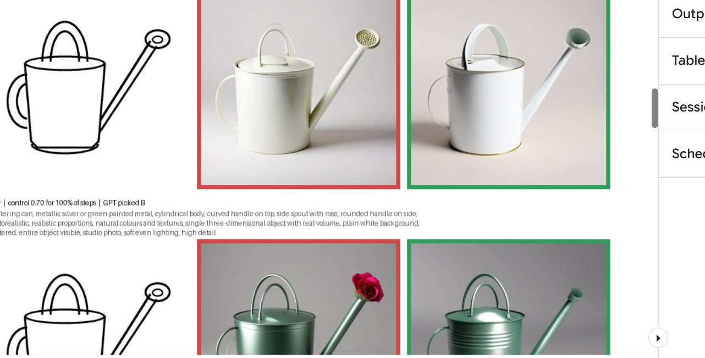
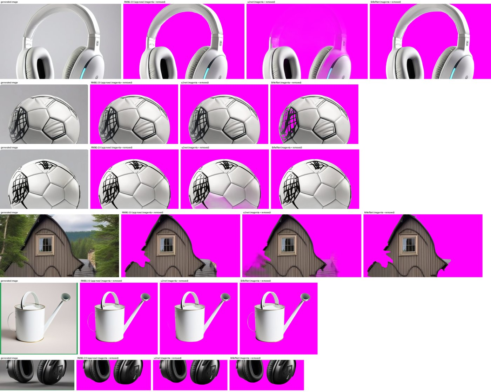
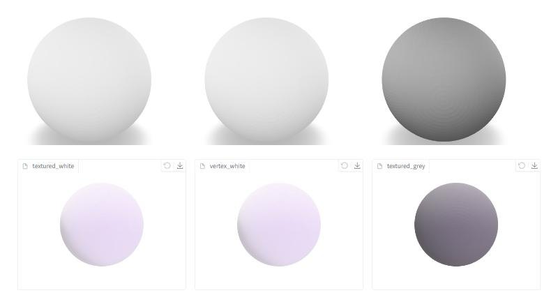

# Sketch2Shape: technical documentation

This document explains how Sketch2Shape turns a 2D sketch into a textured 3D asset, why it is built this
way, what was tested, how long it takes on which hardware, and where it falls short. The
[README](../README.md) is the short version with the quick start.

Contents
1. [Objective and how each requirement is met](#1-objective-and-how-each-requirement-is-met)
2. [System overview](#2-system-overview)
3. [The pipeline, stage by stage](#3-the-pipeline-stage-by-stage)
4. [Run control: state machine and quality gates](#4-run-control-state-machine-and-quality-gates)
5. [Runtime design: GPU workers, memory and loading](#5-runtime-design-gpu-workers-memory-and-loading)
6. [Key implementation decisions](#6-key-implementation-decisions)
7. [Performance and resources](#7-performance-and-resources)
8. [Experiments and evidence](#8-experiments-and-evidence)
9. [Reproducibility](#9-reproducibility)
10. [Error handling and robustness](#10-error-handling-and-robustness)
11. [Testing](#11-testing)
12. [Limitations and known issues](#12-limitations-and-known-issues)
13. [Future work](#13-future-work)
14. [Demonstration guide](#14-demonstration-guide)

---

## 1. Objective and how each requirement is met

**Objective.** Give anyone with an idea a usable 3D asset from a single rough sketch: draw or upload it,
optionally describe it, and get a textured model that keeps the sketch's main structure, has real depth,
and opens in standard 3D software.

| Requirement (problem statement) | Where and how |
|---|---|
| In-app sketching with brush, eraser and reset | Gradio Sketchpad in `app.py`: brush, eraser, undo, clear, white canvas |
| Image upload in common formats | Upload tab (PNG, JPG, WebP), plus one-click example sketches |
| Input preparation (resizing, background, contrast, noise) | `stages/preprocess.py`: flatten transparency, invert light-on-dark, even out paper lighting, Otsu threshold, speck removal, crop and centre, 1024 px square, gap closing, line thickening, hatching to outlines; sideways photos turned upright |
| Optional text prompt, never required | Description box; every step works without it. A typed description comes first in the prompt |
| Identify contours, shapes, structure | The cleaned line art drives a scribble ControlNet; a filled silhouette and the strokes are used for scoring |
| Preserve the sketch's key characteristics | ControlNet conditioning on the line art; gate 1 measures stroke recall, silhouette overlap and CLIP agreement and regenerates when an image drifts |
| Use the prompt for appearance | Typed words lead the prompt; the vision LLM is shown them and keeps their colours and materials |
| Generate a representation for reconstruction | SDXL + ControlNet makes a product-style or photorealistic image on a plain white background |
| Background removal / segmentation | `stages/prepare.py`: rembg cut-out (BRIA RMBG-2.0 in current rembg), colour-threshold fallback, crop, centre, margin |
| Stay related to the sketch, not just the text | The ControlNet always conditions on the sketch; gate 1 rejects images that do not match its shape |
| 3D reconstruction with depth, plausible geometry, texture | Hunyuan3D-2: shape model (turbo, FlashVDM, 380 grid) and texture model; prompts and negatives push against flat "plaque" images |
| Export .glb / .obj | `stages/export.py`: `model.glb` (texture embedded) and `model_obj.zip` (OBJ + MTL + texture) |
| Preview from different angles, download | Embedded `<model-viewer>` (rotate, zoom, auto-rotate) and a Downloads box; earlier models stay viewable |
| Basic mesh validation, file opens, geometry and texture preserved | Gate 2 (`stages/validate.py`) checks faces, finiteness, flatness, fragments and texture; export reloads the GLB and compares geometry |
| Reasonably efficient end-to-end pipeline | Models kept loaded or loaded ahead while other steps run; one run is about 3-6 min on free T4s ([section 7](#7-performance-and-resources)) |
| Disclose models, APIs, third-party components | README "Models, external services and third-party components", with licences |
| Report time, hardware, resources, limitations | [Section 7](#7-performance-and-resources) and [section 12](#12-limitations-and-known-issues) |
| Reproducibility details | [Section 9](#9-reproducibility) and the Kaggle notebook |

---

## 2. System overview

Three layers keep the design simple:

- **Stages** (`sketch2shape/stages/`) are plain functions: input in, output out, files written to the run folder.
- **The controller** (`sketch2shape/pipeline.py`) is a small explicit state machine that calls the stages and owns every decision about what runs next, every retry and the time budget.
- **The model manager** (`sketch2shape/models.py`) runs each heavy model in its own GPU worker process (`sketch2shape/worker.py`) and decides which models stay loaded, which load ahead of time and when RAM must be freed.

The Gradio app (`app.py`), the command line (`sketch2shape/cli.py`) and the batch script
(`scripts/eval_batch.py`) all drive the same pipeline.

---

## 3. The pipeline, stage by stage

### 3.1 Preprocess (`stages/preprocess.py`)

Turns any input (a canvas drawing, a scan, a phone photo of paper) into clean black-on-white line art:

1. Flatten transparency onto white; invert light-on-dark sketches.
2. Even out uneven paper lighting (background division), then Otsu threshold.
3. Drop specks smaller than 20 px (at 1024 px).
4. Crop to the strokes with 12% padding, square, resize to 1024 px.
5. Close tiny gaps and thicken thin pencil lines so the ControlNet sees them.
6. **Hatching to outlines.** Dense hatching or scribbled shading is replaced by the outline of the shaded area. Without this, the ControlNet copied the scribbles literally (a football came out covered in scribble marks). Areas are found by local stroke density (5% window, density above 0.5, at least 0.2% of the image). Tested on five real sketches: only the football's panels and a landscape's shaded trees changed; the headphones, watering can and mug were untouched.
7. A filled silhouette of the sketch is saved for scoring.
8. Empty input (under 0.1% stroke pixels) stops the run with "The sketch looks empty".

Outputs: `01_input.png`, `02_lineart.png`, `03_control.png` (what the ControlNet sees), `04_sketch_mask.png`.

### 3.2 Understand (`stages/understand.py`, `llm.py`)

One optional vision-LLM call (OpenAI `gpt-4.1-mini` by default, or Claude) looks at the sketch and
returns JSON with:

| Field | Used for |
|---|---|
| `object` | the object's name, e.g. "headphones" |
| `details` | at most 10 words on the real object's shape and pose |
| `material` | the colours and surface it most often has (it keeps any the user typed) |
| `drawing` | `clean` or `rough`: decides the generation settings |
| `kind` | `object` or `scene`: a scene is built as a diorama |
| `up` | which edge the top of the drawing points to: sideways photos are turned upright before generation |

Without a key, or on any API error or refusal, CLIP ViT-B/32 picks a name from a fixed list of 181
everyday objects; the pipeline never depends on the API.

### 3.3 Prompt per kind of sketch (`build_prompt`)

The settings below were chosen by a side-by-side comparison on real sketches ([section 8.1](#81-prompt-settings-per-kind-of-sketch)):

| Kind of sketch | Prompt | Sketch control | Images per round |
|---|---|---|---|
| **Clean drawing** (or no LLM judgement) | `a <name>, single object, centered, entire object visible, product photo, plain white background, soft even studio lighting, high detail` | full: scale 0.7 on every step | 1 |
| **Rough doodle** | `a <name>, <colours>, <shape words>, photorealistic, realistic proportions, natural colours and textures, single three-dimensional object with real volume, plain white background, centered, entire object visible, studio photo, soft even lighting, high detail` | 0.7 for the first 80% of the steps, then free | 2 |
| **Scene** (landscape, several things) | `a miniature diorama of <scene>, <colours>, on a small round base, photorealistic, ...` | light: 0.3 for the first 40% of the steps | 2 |
| **Typed description** | the user's words first, then the name if missing; no realism words if the text asks for a style (cartoon, toy, low poly, statue, ...) | as for the kind of sketch | as above |

Negative prompts block multiple objects, cropping, frames and borders, scenery, text, shadows, flat
results (flat, 2D, relief, plaque, cookie cutter, sticker) and glossy highlights that would be baked
into the texture. Every prompt was checked to fit CLIP's 77-token limit (SDXL silently drops the rest),
with room left for the image check's "avoid" words.

### 3.4 Generate (`stages/generate.py`)

Stable Diffusion XL base 1.0 with the xinsir scribble ControlNet and the fp16-safe VAE, 1024 x 1024
px, 25 steps, guidance 6.0, fixed seed 42 (+1000 per round). Black-on-white line art is the control
image. If two images do not fit in GPU memory, the worker makes one.

### 3.5 Gate 1: image check and line scores (`stages/image_check.py`, `stages/score.py`)

1. **Image check (vision LLM).** The sketch and the round's images go to the vision LLM, which picks the one showing a single, complete, real object (or diorama) alone on a plain light background, with real depth and roughly the sketch's shape. It rejects frames, rings, borders, stands, second objects, background scenery, cut-off parts and flat plaques, and returns a few words to avoid next time. Only the picked image is cut out and scored.
2. **Line scores** for the pick: stroke recall against image edges (F2, 50%), silhouette overlap with the sketch (IoU, 30%) and CLIP agreement with the name (20%). Threshold 0.35.

Outcomes: pass; **all rejected** → new seeds, the check's "avoid" words added to the negative prompt,
same sketch control; **pick drifted from the lines** → new seeds and stronger sketch control (+0.1, every
step guided); at most 2 extra rounds within the time budget, after which the best image is used and
the run is flagged. A scene's diorama passes on the image check alone, since its layout is not meant
to match the sketch line for line.

### 3.6 Prepare (`stages/prepare.py`)

Background removal with rembg through Hunyuan3D-2's `BackgroundRemover` (rembg's default model, BRIA
RMBG-2.0 in current versions), reused from scoring; a colour-threshold fallback if the cut-out looks
wrong (under 3% or over 95% of the image). The object is cropped, centred with a 15% margin and placed
on a transparent 1024 px square (`06_prepared.png`), the framing the 3D model expects.

### 3.7 Reconstruct (`stages/reconstruct.py`, `worker.py`)

- **Shape:** Hunyuan3D-2 `hunyuan3d-dit-v2-0-turbo` (5 steps), FlashVDM decoding, marching cubes on a 380 grid, then Hunyuan's floater removal, degenerate-face removal and reduction to about 40k faces. Seed 1234 (+7919 per attempt). If the turbo weights are unavailable it falls back to the base model (50 steps).
- **Texture:** Hunyuan3D-2's paint pipeline (light removal, multi-view diffusion, baking into a UV texture) on the checked shape, with a retry using CPU offload if the GPU runs out of memory.
- **Fallback:** if texturing is off, fails, fails its check or the time budget is spent, colours are projected from the prepared image onto the mesh, so the model always has colour.

### 3.8 Gate 2: validate (`stages/validate.py`)

Checks the mesh is non-empty with at least 500 faces, finite, not flat (smallest box side at least 8%
of the largest), and has no loose fragments (pieces under 2% of the surface are removed; connectivity is
computed on position-merged geometry, so UV seams do not count as fragments). A failing shape is
rebuilt with a new seed (up to 2 attempts, the best one is kept); a failing texture falls back to
projected colours.

### 3.9 Export (`stages/export.py`)

The mesh is centred, scaled to 1 unit, made Y-up and set to rest on y = 0. Materials are made matte
and neutral (metallic 0, roughness 0.85, white base factor) so textures show their true colours in any
viewer (trimesh's defaults had made models look black or metallic). It writes `model.glb` and
`model_obj.zip`, then reloads the GLB and compares its geometry (`reload_ok` in the manifest).

### 3.10 The app (`app.py`)

- Draw and Upload tabs, the description box, **Make 3D model** and **Cancel**.
- A progress panel: a bar weighted by how long each step usually takes, the current step with elapsed time, the finished steps with their outcome and time.
- A status line under the panel: whether SDXL and the 3D shape model are loaded or loading.
- Live intermediate images (cleaned sketch, images with their score or "rejected by the image check", cut-out) and the untextured shape while the texture is painted.
- A rotatable 3D viewer (Google `<model-viewer>`, neutral lighting) and downloads; **Run details** with the run summary; **Previous models** to reopen earlier runs with their images and details.
- One model at a time (also across page reloads); Cancel stops GPU work at once.

---

## 4. Run control: state machine and quality gates

`pipeline.py` defines the states and a transition table; handlers return an outcome word and only the
controller picks the next state:

| From | Outcome | Next |
|---|---|---|
| preprocess | ok / empty | understand / failed ("draw or upload a sketch with clearly visible lines") |
| understand | ok | generate |
| generate | ok | score |
| score (gate 1) | pass / retry / give up | prepare / generate / prepare (best image, flagged) |
| prepare | ok | shape |
| shape | ok / retry / use best / error | check shape / shape / texture / failed |
| check shape (gate 2) | pass / retry / accept flagged | texture / shape / texture |
| texture | ok / fallback | check texture / export (projected colours) |
| check texture | pass / fallback | export |
| export | ok | done |

Every loop has an attempt limit and the whole run a time budget (900 s for retries). An unexpected
error in any stage is caught; if any mesh exists, the best one is exported instead of failing. A
cancelled run ends after the current step with the outcome "cancelled" and exports nothing. Each step's
outcome, duration, clean-up time, the app's RAM and the free RAM are logged in `manifest.json` →
`transitions`.

---

## 5. Runtime design: GPU workers, memory and loading

**Why worker processes.** Keeping SDXL, the shape model and the texture model in one process ran out
of Kaggle's 30 GB of CPU RAM (peak 31 GB while loading the texture model). Each heavy model therefore
runs in its own worker process, pinned to a GPU with `CUDA_VISIBLE_DEVICES`. Jobs and results are small
JSON files; images and meshes are passed as paths. A process gives all of its memory back when it ends,
and a crash inside one model cannot take down the app. Workers also run with glibc settings that return
freed memory at once (`MALLOC_ARENA_MAX=2`, low mmap/trim thresholds), and the app trims its own heap
after every step.

**Three ways a model runs** (`models.py`), all producing identical output:

| Mode | Used for | Effect |
|---|---|---|
| **kept loaded** | SDXL on GPU 0 and the shape model on GPU 1 (two GPUs) | loaded at app start and reloaded after each run; no loading inside a run |
| **loaded early** | the texture model on GPU 0 | starts loading as soon as the image is chosen, while the cut-out, scores and shape run |
| **fresh** | everything on a single GPU, or when RAM is short | load, one job, exit |

**GPU plan on 2x T4.** GPU 0 holds SDXL while images are made (13.4 GB peak). Once the image is
chosen, SDXL is stopped and GPU 0 paints the texture (12.7 GB peak). GPU 1 keeps the shape model
(6.2 GB peak). After the run, SDXL reloads on GPU 0 in the background.

**RAM guard.** Each Hunyuan model needs about 15 GB of RAM while it loads. A worker loads early or
reloads only when no other worker is loading, its GPU is free, and at least 16 GB of RAM is free
(cgroup limit minus non-cache usage). Before the texture model loads fresh, kept models are stopped if
RAM is short (`make_room_for`). This rule comes from a real failure: with SDXL kept loaded, the texture
model was killed by the kernel for RAM and the run fell back to projected colours.

**Cancel.** Workers of the current run are killed; a kept worker only drops its current job (SDXL
stops within a step) and stays loaded.

---

## 6. Key implementation decisions

| Decision | Why | Alternatives considered |
|---|---|---|
| **Sketch → image → 3D** (two stages) | Image-to-3D models are trained on images, not line drawings; generating a clean product-style image first gives them the input they handle best and lets the text prompt control appearance | Direct sketch-to-3D models: few, weaker, not runnable on a T4 |
| **SDXL + xinsir scribble ControlNet** | Strong at turning rough lines into objects; SDXL at 1024 px gives cleaner images than SD 1.5; runs on a T4 in fp16 | SD 1.5 scribble (weaker images); FLUX (too large for a T4); photoreal SDXL fine-tunes (dropped: current images were judged good enough) |
| **Hunyuan3D-2 for shape and texture** | Among the open image-to-3D models that fit a 15 GB T4 (shape and texture run as separate steps), it had the strongest published geometry and textured output; one pinned repository covers both steps | InstantMesh / Unique3D (suggested in the brief; not run here, chosen against on published results and setup effort, see the architecture decision PDF), TRELLIS (needs more GPU memory and GPU features than a T4 has), Hunyuan3D-2.1 (texture needs ~29 GB) |
| **Plain-Python state machine with two deterministic gates** | The control flow is short and known; the uncertainty is in model outputs, so the pipeline measures them. Repeatable (fixed seeds), no added latency, easy to test | An agent framework or an LLM deciding the next step: more latency, less repeatable, harder to debug ([architecture decision PDF](Sketch2Shape%20Architecture%20Decision.pdf)) |
| **Optional vision LLM in two narrow roles** (naming, image check) | It judges what scores cannot: what the object is, whether a drawing is rough, whether an image has a ring around the object. Each call is cheap and has a deterministic fallback | No LLM (worked, but missed rings and scenery), LLM-controlled pipeline (rejected above) |
| **Settings per kind of sketch, chosen by experiment** | One setting could not serve both: the product-photo prompt made clean drawings look right but turned doodles into rope; realism words did the opposite | Guessing one global setting (tried first; the comparison showed the trade-off) |
| **Worker processes, models kept loaded or loaded early** | RAM safety plus about 2-3 minutes less loading per run, with identical output | One process with every model (ran out of RAM), loading every model fresh each step (slow) |
| **Explicit export material and a reload test** | Generated GLBs looked black or metallic in viewers until the material was set; the reload test proves the file opens with its geometry | Trusting the library defaults |
| **`<model-viewer>` for the preview** | A side-by-side test showed Gradio's Model3D viewer tinting pure white and grey models lavender; model-viewer showed their real colours | Gradio Model3D (tint) |

---

## 7. Performance and resources

**Hardware used:** Kaggle notebook, 2x NVIDIA T4 (15 GB usable each), 4 vCPU, 30 GB RAM, ~57 GB
disk; Python 3.13, PyTorch 2.11 + CUDA 12.8. No paid compute. One-time setup on a fresh session takes
about 15-25 minutes (Hunyuan3D-2 install, two CUDA extensions compiled in ~25 s, ~20 GB of weights).

**Measured run times (app on Kaggle).**

| Run | Settings | Total | Notes |
|---|---|---|---|
| Cat doodle, 1 Nov | every model loaded fresh, 768 px | 357 s | |
| Cat doodle, 1 Nov | every model loaded fresh, 768 px | 389 s | 179 s of it was loading the three models, 47 s starting worker processes, 74 s actual GPU work |
| Headphones photo, 1 Nov | SDXL kept loaded, 1024 px | 309 s | texture step killed for RAM → projected colours; led to the RAM guard |

**Per step, where the time goes** (measured on the T4s):

| Step | Work | Loading the model (when not kept) |
|---|---|---|
| Naming (vision LLM) | 2-3 s | - |
| SDXL + ControlNet, 1024 px, 25 steps | ~38 s for 1 image, ~76 s for 2 | 41-85 s |
| Image check (vision LLM) | 1-4 s | - |
| Cut-out + line scores (CPU) | ~30 s | overlaps the texture model's loading |
| Shape (turbo, 380 grid) + clean-up | ~29 s | 65-99 s |
| Texture | 40-50 s | ~72 s |
| Export + reload test | 2-5 s | - |

**With the current loading plan**, SDXL and the shape model are already loaded and the texture model
loads during the cut-out and shape steps, so a run after the first is expected to take **about 3-4
minutes** (clean drawing about 3, rough doodle about 3.5-4); the first run after the app starts takes
about 5 minutes. SDXL reloads in the background after a run (~1.5 min), so a run started immediately
after another waits for it. Exact numbers for any run are in its `manifest.json` (`timings_s`,
`workers` with load, wait and run times, `transitions`) and in the app's Run details;
`scripts/collect_results.py` tabulates them.

**Memory.**

| Process | GPU (peak) | CPU RAM (peak) |
|---|---|---|
| SDXL worker | 13.4 GB (2 images at 1024 px), GPU 0 | ~6 GB |
| Shape worker | 6.2 GB, GPU 1 | ~14.6 GB while loading |
| Texture worker | 12.7 GB, GPU 0 | ~15.5 GB while loading |
| App (CLIP, background removal, Gradio) | none | ~4-6 GB |

Workers record their RAM after loading and after each job (`rss_after_load_gb`, `rss_gb`), and every
step records the free RAM, so the loading plan can be checked on each run.

**Cost:** free hardware; the optional vision-LLM calls cost well under one US cent per model (images
sent at low detail).

---

## 8. Experiments and evidence

Decisions were tested on real sketches rather than assumed. The scripts are in `scripts/`.

### 8.1 Prompt settings per kind of sketch

`scripts/compare_settings.py` cleaned up and named each sketch once, then made two images per variant
with the same seeds and let the image check mark the usable one. Variants: the original settings
("before"), the realistic prompt ("now"), a product-photo look, no LLM colours, firmer sketch control.

| Sketch | Kind | Best variant | What went wrong in the others |
|---|---|---|---|
| Watering can | clean drawing | plain product photo with only the name | LLM details added mistakes: "spout with rose" painted a red flower |
| Headphones (paper photo) | clean drawing | plain product photo with only the name | "black plastic" put the headphones on a dark background, bad for the cut-out |
| Cat (mouse doodle) | rough doodle | LLM colours + realism words; firmer control (0.7 for 80%) as good as lighter | the plain product prompt turned the doodle into a tangle of rope |

### 8.2 Background removal

The same six images from real runs were cut out by the app's model (BRIA RMBG-2.0 via rembg), u2net and
BiRefNet. RMBG-2.0 was clean on all six. u2net left see-through patches (most of a white headband, the
bottom of a ball), which become holes or lumps in 3D. BiRefNet cut holes through a scribbled pattern.
The app's current model was kept.

### 8.3 Viewer colours

White models looked lavender in the app. Pure white and grey test spheres, exported exactly as the app
exports models, were shown side by side: Gradio's Model3D tinted them (bottom), Google's model-viewer
showed their true colours (top). The files were fine; the app's viewer was replaced.

### 8.4 Failures that shaped the design

| What happened | Cause found | Change |
|---|---|---|
| A cartoon cat became a flat embossed plaque | the line-following image was a relief; nothing asked for volume | "real volume" in the prompt; flat/relief/plaque/sticker negatives |
| A football became a ball inside a ring, then a drum in 3D | the line scores only measured adherence | the vision-LLM image check in gate 1; "picture frame, border" negatives; "whole object in frame" removed |
| A sideways landscape photo became a cabin with hills painted on its walls | the pipeline assumed one upright object | upright check; scenes built as dioramas with light sketch control |
| A hatched football came out covered in scribbles | the ControlNet copies strokes literally | hatching turned into outlines |
| The texture step was killed; models came out with flat projected colours | SDXL kept loaded (~6 GB) + texture load (~15 GB) exceeded 30 GB RAM | SDXL released once the image is chosen; RAM guard; RAM logged per step |
| Models looked black, metallic or lavender | library default materials; Gradio viewer lighting | matte export material; model-viewer |

---

## 9. Reproducibility

| | |
|---|---|
| **Environment** | Linux with an NVIDIA GPU and CUDA; tested on Kaggle 2x T4 (Python 3.13, PyTorch 2.11 + CUDA 12.8). One GPU with 16 GB or more also works (every model loads fresh). About 30 GB RAM and ~30 GB free disk for weights and runs |
| **Install** | `scripts/setup.sh`: clones Hunyuan3D-2 and checks out commit `f8db630`; installs its requirements; compiles its two CUDA extensions (`custom_rasterizer`, `differentiable_renderer`) for the GPUs present, falling back from pip to `setup.py install`; patches one line of Hunyuan's multi-view loader (`trust_remote_code=True`, needed by newer diffusers); installs `requirements.txt`; prefetches the weights (`scripts/prefetch_weights.py`) |
| **Kaggle** | `notebooks/kaggle_run.ipynb`: cells 1-4 in order give the app's public link; the rest is optional |
| **Model weights** | downloaded on first use from public Hugging Face repositories (SDXL base 1.0, xinsir scribble ControlNet, sdxl-vae-fp16-fix, Hunyuan3D-2, CLIP ViT-B/32) and rembg's GitHub releases (background-removal model); none needs approval. `HF_TOKEN` is optional (higher rate limits) |
| **External services** | optional: OpenAI API (`OPENAI_API_KEY`) or Anthropic API (`ANTHROPIC_API_KEY`) for naming and the image check; cdn.jsdelivr.net for the 3D viewer script; gradio.live for the public link. Without an API key every step still runs |
| **Configuration** | `config.yaml`, every value commented (GPU placement, worker plan, prompts per kind of sketch, gates, export). A run stores the full configuration, the library versions and the GPU names in its `manifest.json` |
| **Determinism** | fixed seeds (images 42 + 1000 per round, shape 1234 + 7919 per attempt) and fixed settings; the vision LLM's answers can vary, and so can GPU kernels slightly |
| **Run record** | every run folder holds all intermediate images and meshes and `manifest.json` (inputs, prompts, seeds, scores, image-check verdicts, transitions, worker times and RAM, warnings) |
| **Tests** | `python -m pytest -q tests`: 50 tests, no GPU or network needed |

---

## 10. Error handling and robustness

- **Empty or blank sketch:** stops early with a clear message instead of generating noise.
- **No API key, API error, refusal or unusable answer:** naming falls back to CLIP; the image check steps aside and the line scores decide.
- **Bad image:** regenerated with new seeds, "avoid" words or stronger sketch control; after the limit, the best image is used and the run is flagged.
- **GPU out of memory:** SDXL drops to one image; texturing retries with CPU offload.
- **Worker crash or timeout:** the error and the worker's log path are reported; a crashed kept worker is restarted on the next run.
- **Shape problems:** a new seed, then the best shape so far.
- **Texture problems:** colours projected from the image, so the model is never grey.
- **Any unexpected error after a mesh exists:** the best mesh is exported anyway.
- **RAM:** loads are gated on free RAM; kept models make room before the texture model loads.
- **Leftover workers** from an interrupted session are stopped when the app starts.
- **UI:** one run at a time (also across page reloads), Cancel, no crash on half-written images.
- **Export:** atomic writes for every worker output; the GLB is reloaded and checked.

---

## 11. Testing

`tests/` holds 50 offline tests (no GPU, no network) covering:

- preprocessing of canvas drawings and unevenly lit photos, empty input, hole filling, hatching to outlines, turning sketches upright;
- scoring maths (stroke fidelity, IoU) and gate 1 decisions with a scripted image check: pass, reject and retry with avoid words, drift and stronger control, dioramas, no key;
- mesh checks (flat plates, fragments, UV seams), colour projection, export round trips (geometry, textures, matte materials, OBJ colours);
- the state machine (every state has a way out, retries, recovery after an unexpected error, cancel);
- worker processes (round trip, kept workers serving several jobs, early workers, cancel of kept and fresh workers, RAM guard, GPU sharing rules);
- the vision-LLM calls with a fake OpenAI client (model fallback, rejected key, unusable answers, typed descriptions, prompts per kind of sketch, image check).

---

## 12. Limitations and known issues

- **Single view.** One sketch does not show the back or the inside: hidden surfaces are the model's plausible guess, not recovered geometry.
- **Shaded colour on clean drawings.** Hatching becomes an outline so it is not copied as scribbles, and the clean-drawing prompt carries only the name, so the colour the shading stood for can be lost (a hatched football came out white). Typing the colour fixes it.
- **Scenes are dioramas.** A landscape is built as one miniature diorama; it keeps the content (cabin, trees) more than the exact layout.
- **Thin and fine parts.** Handles, legs and spouts can thicken, merge or break; small sketch details (text, patterns) are not reproduced exactly; hidden sides are painted by the texture model.
- **Run time.** About 3-6 minutes per model on free T4s, longer for the first run after start-up and for a run started right after another (SDXL reloading). One model at a time.
- **Hardware.** Needs an NVIDIA GPU (16 GB or more) and about 30 GB of RAM; no CPU-only mode.
- **Vision LLM optional but useful.** Without a key, naming uses a fixed list of 181 objects and the image check is skipped.
- **Licences.** Hunyuan3D-2 (Tencent Hunyuan 3D 2.0 Community License) and BRIA RMBG-2.0 (CC BY-NC 4.0) are non-commercial; the Hunyuan licence excludes the EU, UK and South Korea.
- **Geometry scope.** Meshes are for viewing and further editing; they are not manifold-checked for 3D printing or retopologised for animation (outside the problem's scope).
- **Background-removal model depends on the rembg version.** Hunyuan's remover uses rembg's default model, RMBG-2.0 in current versions and u2net in older ones.

---

## 13. Future work

- Keep the shaded colour: name the colour of hatched areas and add it to clean-drawing prompts (prototyped, not enabled).
- A photoreal SDXL fine-tune (e.g. RealVisXL) if a comparison shows a clear gain.
- Multi-view generation (consistent side and back views) for better hidden geometry.
- Background removal on the GPU to shorten the CPU step.
- PBR materials (Hunyuan3D-2.1) on a larger GPU.

---

## 14. Demonstration guide

1. Start the app (Kaggle cells 1-4) and wait for "SDXL ready · 3D shape model ready".
2. **Live sketch:** let a judge draw on the canvas or upload a photo; leave the description empty to show it is optional, or add one ("a red ceramic mug") to show prompt control.
3. Narrate the progress panel: cleaned sketch → generated image and the image check's verdict → cut-out → untextured shape (rotatable) → textured model.
4. Rotate the model in the viewer, download the GLB and open it in another viewer; open **Run details** to show the prompt, the kind of sketch, the image-check verdict, the scores and the timings.
5. Explain the key decisions: the two-stage design, settings per kind of sketch chosen by experiment, the two quality gates, worker processes and the RAM guard ([section 6](#6-key-implementation-decisions)).
6. Show **Previous models** and the example outputs in `examples/outputs/`.
