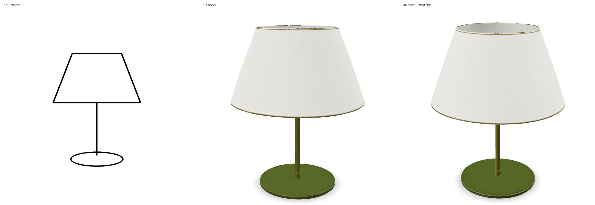
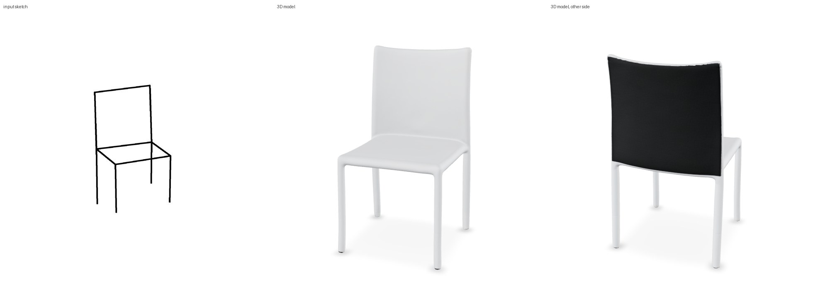
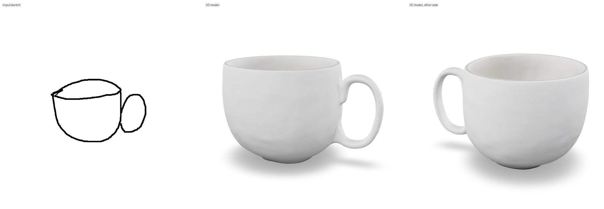
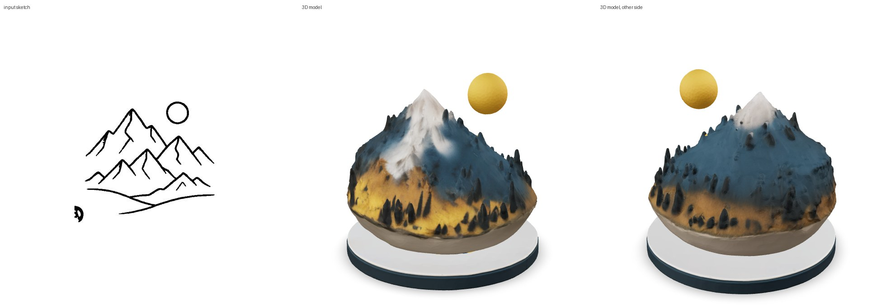
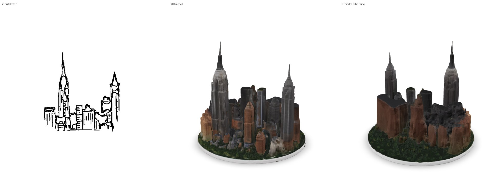
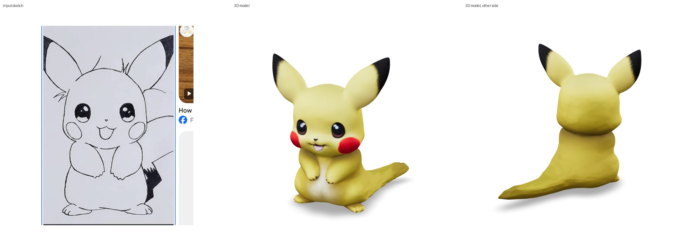
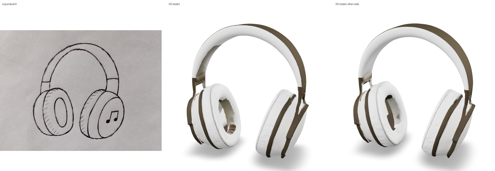

# Examples

## Inputs paired with outputs

Each folder in [`outputs/`](outputs/) holds one input and what the app made from it on Kaggle's free 2x T4:

- `input.*` - the sketch as uploaded
- `model.glb` - the textured model from the app's download button
- `model_obj.zip` - the same model as OBJ + MTL + texture
- `preview.jpg` - input | 3D model | other side

Open a GLB in any glTF viewer, e.g. drag it onto <https://modelviewer.dev/editor/>.

| Example | Input | Preview | Files |
|---|---|---|---|
| Table lamp | plain line drawing |  | [GLB](outputs/table_lamp/model.glb) · [OBJ](outputs/table_lamp/model_obj.zip) |
| Chair | simple line drawing |  | [GLB](outputs/chair/model.glb) · [OBJ](outputs/chair/model_obj.zip) |
| Coffee mug | wobbly doodle |  | [GLB](outputs/coffee_mug/model.glb) · [OBJ](outputs/coffee_mug/model_obj.zip) |
| Hills | mountains and sun (scene, built as a diorama) |  | [GLB](outputs/hills/model.glb) · [OBJ](outputs/hills/model_obj.zip) |
| New York skyline | ink drawing (scene, built as a diorama) |  | [GLB](outputs/ny_skyline/model.glb) · [OBJ](outputs/ny_skyline/model_obj.zip) |
| Pikachu | screenshot of a pencil drawing |  | [GLB](outputs/pikachu/model.glb) · [OBJ](outputs/pikachu/model_obj.zip) |
| Headphones | phone photo of a pen sketch |  | [GLB](outputs/headphones/model.glb) · [OBJ](outputs/headphones/model_obj.zip) |

## Sketches to try

[`sketches/`](sketches/) holds the sketches shown as one-click examples in the app, including two
phone photos (`headphones_photo.png`, `sleeping_cat_photo.png`). [`prompts.json`](prompts.json)
gives optional descriptions for some of them, used by `scripts/eval_batch.py`.
